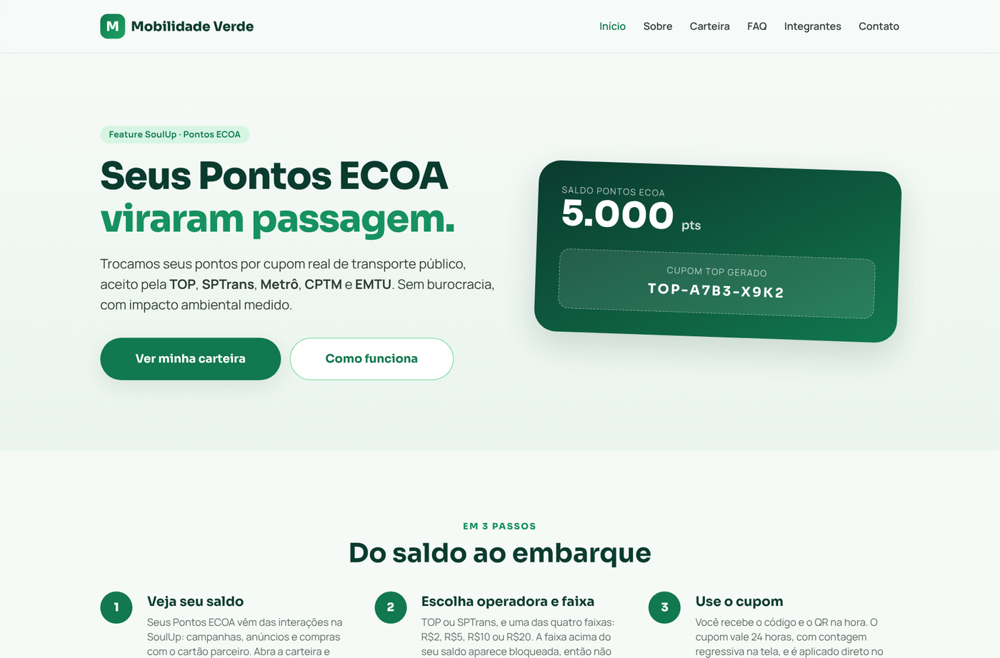
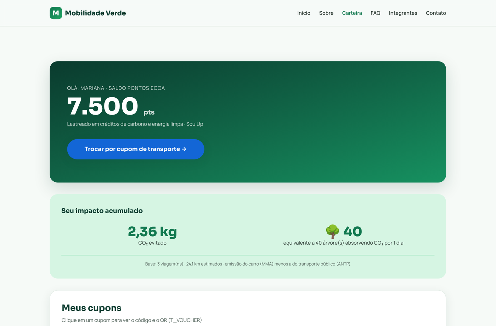
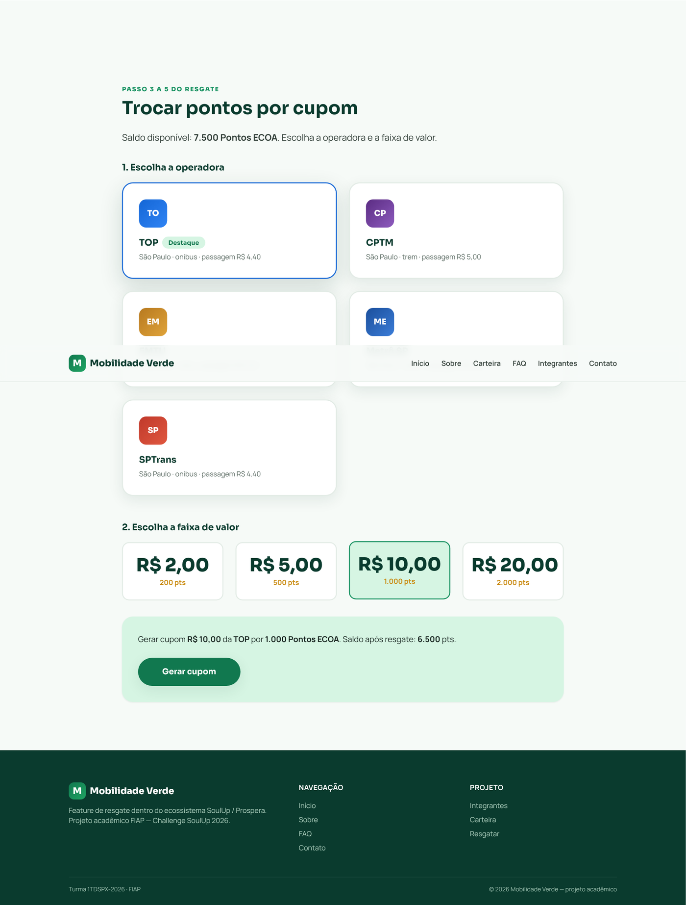
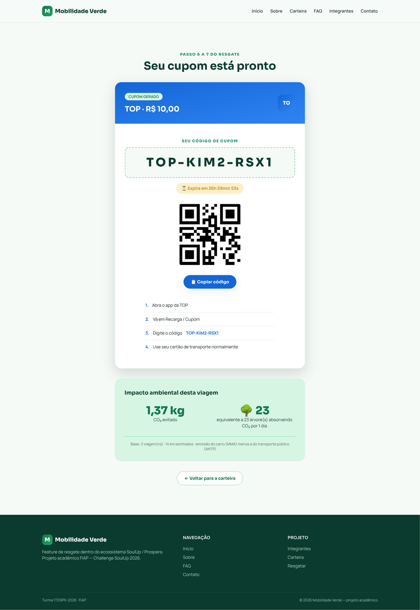
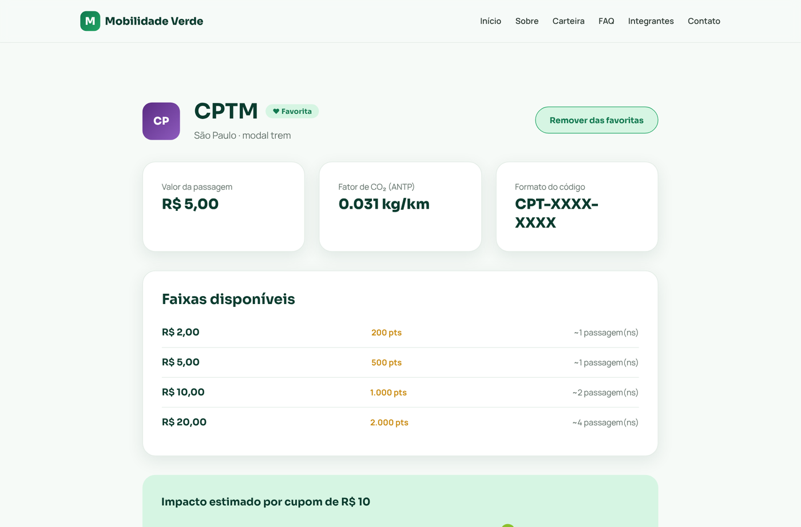
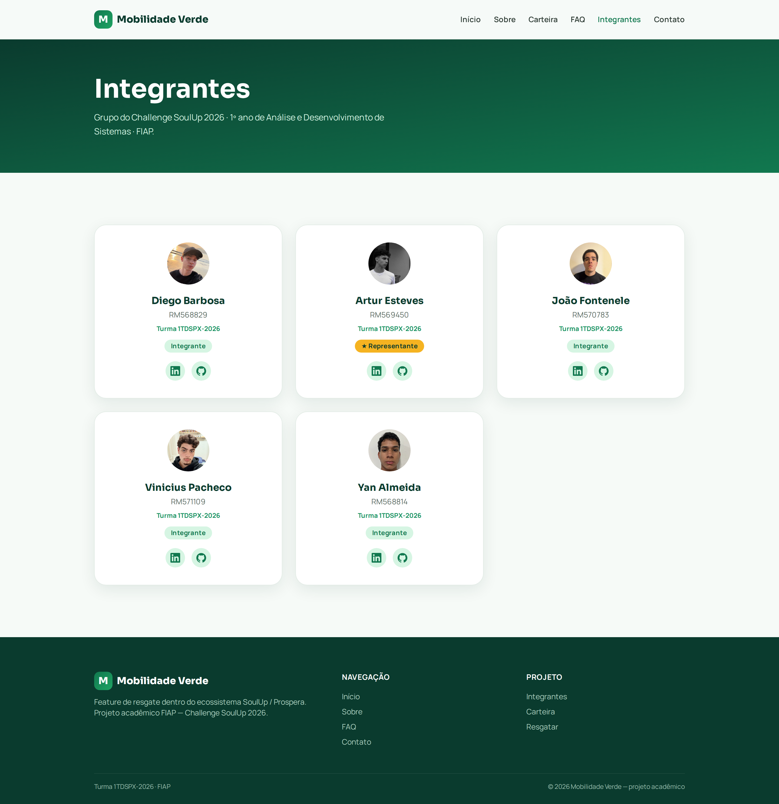

# 🌱 Mobilidade Verde

**Troque seus Pontos ECOA por cupom real de transporte público.**

Mobilidade Verde é uma feature dentro da **SoulUp** (grupo Prospera), rede social e programa de fidelidade onde o usuário acumula **Pontos ECOA** — moeda digital verde lastreada em créditos de carbono e energia limpa.

A geração de pontos já existe na plataforma e está fora do nosso escopo. O que este projeto entrega é o **caminho de resgate**: transformar Pontos ECOA em cupom de transporte público aceito pelas operadoras parceiras — **TOP**, **SPTrans**, **Metrô SP**, **CPTM** e **EMTU**.

O usuário abre a carteira, vê o saldo, escolhe a operadora e a faixa de valor, e recebe na hora um cupom com código único, QR Code e validade de 24 horas — junto com o cálculo de quanto CO₂ aquela viagem deixa de emitir.

> **Challenge SoulUp 2026 · FIAP · Sprint 4 · Front-End Design Engineering**
> Turma **1TDSPX-2026** — 1º ano de Análise e Desenvolvimento de Sistemas

| | |
|---|---|
| 🌐 **Aplicação na Vercel** | https://mobilidade-verde-front.vercel.app |
| 🔌 **API Java (Render)** | https://mobilidade-verde-java-sprint4.onrender.com |
| 📦 **Repositório do front** | https://github.com/EstevesArtur/mobilidade-verde-front |
| ☕ **Repositório da API** | https://github.com/EstevesArtur/Mobilidade-Verde-JAVA-Sprint4 |
| 🎥 **Vídeo (Sprint 4)** | _link do YouTube — preenchido na entrega_ |

### O que mudou na Sprint 4

Na Sprint 3 os dados eram simulados em `src/data/`. Agora **todas as telas da solução consomem a API REST em Java** (Spring Boot + JDBC + Oracle) publicada no Render — sem Axios, só `fetch()` nativo:

| Operação | Método | Endpoint | Onde aparece |
|---|---|---|---|
| Listar operadoras | `GET` | `/api/operadoras` | Home, Resgatar |
| Detalhe da operadora | `GET` | `/api/operadoras/{id}` | `/operadoras/:id` |
| Listar faixas | `GET` | `/api/faixas` | Resgatar |
| Usuário e saldo | `GET` | `/api/usuarios/{id}` | Carteira, Resgatar |
| Cupons do usuário | `GET` | `/api/usuarios/{id}/vouchers` | Carteira |
| Histórico de pontos | `GET` | `/api/usuarios/{id}/transacoes` | Carteira |
| Impacto acumulado | `GET` | `/api/usuarios/{id}/impacto` | Carteira |
| Buscar cupom | `GET` | `/api/vouchers/{codigo}` | `/cupom/:codigo` |
| **Gerar cupom** | **`POST`** | `/api/vouchers` | Resgatar |
| **Cancelar cupom (estorno)** | **`POST`** | `/api/vouchers/{codigo}/estornar` | Carteira |
| **Favoritar operadora** | **`POST`** | `/api/usuarios/{id}/favoritas` | `/operadoras/:id` |
| **Remover favorita** | **`DELETE`** | `/api/usuarios/{id}/favoritas/{idFav}` | `/operadoras/:id` |

As regras de negócio (saldo insuficiente, limite antifraude de 5 cupons ativos, validade de 24h) ficam no servidor; o front apresenta a mensagem que a API devolve.

> ⏱ A API está no plano gratuito do Render e **hiberna após 15 minutos sem uso**: a primeira requisição pode levar até 1 minuto. A tela mostra o estado de carregamento e, se precisar, o botão "Tentar novamente".

---

## 📸 O projeto

### Home


### Carteira — saldo, cupons e histórico


### Resgate — escolha de operadora e faixa


### Cupom — código, QR e impacto ambiental


### Operadora — favoritar (POST) e remover (DELETE)


### Integrantes


### Responsividade — 480px


---

## 🛠️ Tecnologias utilizadas

| Tecnologia | Versão | Papel no projeto |
|---|---|---|
| **React** | 19.2 | Biblioteca de interface, componentes funcionais e hooks |
| **Vite** | 8.2 | Build e servidor de desenvolvimento |
| **TypeScript** | 6.0 | Tipagem estática de componentes, props e dados |
| **TailwindCSS** | 4.3 | Estilização por classes utilitárias, sem CSS externo |
| **React Router DOM** | 7.18 | SPA com layout compartilhado, rotas estáticas e dinâmicas |
| **React Hook Form** | 7.87 | Formulário de contato com validação e tipagem |
| **Google Fonts** | — | Sora (títulos) e Manrope (corpo) |
| **API QR Server** | — | Geração do QR Code do cupom, via tag `img` |
| **Fetch API** | nativa | Consumo da API Java — sem Axios |
| **Vercel** | — | Deploy do front com rewrite de SPA (`vercel.json`) |

**Hooks utilizados:** `useState`, `useEffect`, `useCallback`, `useRef`, `useParams`, `useNavigate`, `useLocation`, além do hook próprio `useRequisicao` (carregando / erro / vazio / sucesso).

**Sem bibliotecas de UI e sem cliente HTTP externo.** Nenhum Bootstrap, Material UI ou Axios. Toda a identidade visual é construída com classes Tailwind sobre os tokens da paleta SoulUp.

### Identidade visual

| Camada | Cor | Uso |
|---|---|---|
| Verde Soul | `#0A3B2E` → `#D6F5E3` | marca, superfícies, textos |
| Âmbar ECOA | `#C98A0E` → `#FDEFC8` | pontos, valores, destaques |
| Azul-trânsito | `#1366D6` → `#DCEBFF` | exclusivo da camada de transporte |

Os tokens de cor, as fontes e os breakpoints são declarados no bloco `@theme` do `src/index.css`, o arquivo de entrada oficial do Tailwind v4.

### Responsividade

Os breakpoints do tema foram redefinidos para corresponder exatamente aos exigidos no projeto:

| Faixa | Prefixo Tailwind | Largura |
|---|---|---|
| Mobile | *(padrão)* | até 480px |
| Tablet | `md:` | 768px |
| Desktop | `lg:` | 992px ou mais |

---

## 📁 Estrutura de pastas

mobilidade-verde-front/
├── public/
│ └── img/
│ ├── integrantes/ # fotos dos 5 integrantes
│ ├── screenshots/ # capturas usadas neste README
│ ├── top.svg
│ └── sptrans.svg
├── src/
│ ├── components/
│ │ ├── layout/ # Header, Footer, Layout
│ │ ├── ui/ # Botao, Card, Badge, Secao, CampoErro...
│ │ └── mobilidade/ # componentes de domínio do resgate
│ ├── pages/ # uma página por rota
│ ├── data/ # conteúdo estático (FAQ, passos, integrantes)
│ ├── hooks/ # useRequisicao: estados de tela da API
│ ├── types/ # interfaces do front (espelho do DDL) + api.ts (contratos da API)
│ ├── services/ # camada de integração com a API Java
│ │ ├── api/ # cliente-http.ts (único fetch) + adaptadores.ts
│ │ ├── mobilidade-service.ts
│ │ ├── voucher-service.ts
│ │ └── favorita-service.ts
│ ├── utils/ # formatação e cálculo de CO₂
│ ├── App.tsx # declaração de todas as rotas
│ ├── main.tsx # ponto de entrada
│ └── index.css # ÚNICO arquivo CSS: entrypoint do Tailwind
├── .env.example # VITE_API_URL
├── vercel.json # rewrite de SPA
├── index.html
├── package.json
├── tsconfig.json
├── vite.config.ts
└── README.md


### Rotas

| Rota | Página | Tipo |
|---|---|---|
| `/` | Home | estática |
| `/sobre` | Sobre | estática |
| `/integrantes` | Integrantes | estática |
| `/faq` | Perguntas frequentes | estática |
| `/contato` | Contato | estática |
| `/carteira` | Carteira ECOA | estática |
| `/resgatar` | Resgate de cupom | estática |
| `/cupom/:codigo` | Cupom | **dinâmica** |
| `/operadoras/:idOperadora` | Detalhe da operadora | **dinâmica** |
| `*` | Página não encontrada | fallback |

### Coerência com o modelo de dados

As interfaces em `src/types/` espelham as tabelas do modelo relacional do grupo. As constraints `CHECK` do banco viraram *union types* no TypeScript:

```ts
type StatusVoucher = "GERADO" | "UTILIZADO" | "EXPIRADO" | "CANCELADO";
type Modal = "ONIBUS" | "METRO" | "TREM" | "MISTO" | "BRT";
```

Campos sensíveis do banco — `hash_senha`, `cpf_hash`, `hash_validacao` e `ip_origem` — **não são expostos no front-end** por decisão de segurança.

### Camada de integração

Um único arquivo chama `fetch()`: `src/services/api/cliente-http.ts`. Ele lê a URL base de `VITE_API_URL`, converte erros da API (`{status, erro, mensagem}`) em `ErroHttp` e devolve JSON tipado. Os `adaptadores.ts` traduzem o `camelCase` da API para o `snake_case` dos tipos do front — por isso nenhuma tela precisou ser reescrita entre a Sprint 3 e a 4.

### Impacto ambiental

O impacto acumulado da carteira vem da API (`/api/usuarios/{id}/impacto`, calculado a partir de `T_VIAGEM`). A estimativa por cupom segue a fórmula local: CO₂ evitado = km × (0,180 do carro − fator da operadora), com fontes MMA e ANTP.

---

## 👥 Autores

Equipe **FOG** · Turma **1TDSPX-2026** · FIAP · 1º ano de Análise e Desenvolvimento de Sistemas

<table>
  <tr>
    <td align="center" width="20%">
      <br>
      <b>Diego Barbosa</b><br>
      RM568829<br>
      <sub>1TDSPX-2026</sub><br>
      <sub>Banco de Dados</sub><br><br>
      <a href="https://www.linkedin.com/in/diego-barbosa-rodrigues-a60677321">LinkedIn</a> ·
      <a href="https://github.com/DiegoRodri1">GitHub</a>
    </td>
    <td align="center" width="20%">
      <br>
      <b>Artur Esteves</b> ⭐<br>
      RM569450<br>
      <sub>1TDSPX-2026</sub><br>
      <sub>Front-End · <b>Representante</b></sub><br><br>
      <a href="https://www.linkedin.com/in/artur-esteves-31bb4130a/">LinkedIn</a> ·
      <a href="https://github.com/EstevesArtur">GitHub</a>
    </td>
    <td align="center" width="20%">
      <br>
      <b>João Fontenele</b><br>
      RM570783<br>
      <sub>1TDSPX-2026</sub><br>
      <sub>Java</sub><br><br>
      <a href="https://www.linkedin.com/in/jo%C3%A3o-fontenele-65b1913a8/">LinkedIn</a> ·
      <a href="https://github.com/joaofontenele06">GitHub</a>
    </td>
    <td align="center" width="20%">
      <br>
      <b>Vinicius Pacheco</b><br>
      RM571109<br>
      <sub>1TDSPX-2026</sub><br>
      <sub>Python</sub><br><br>
      <a href="https://www.linkedin.com/in/vinicius-pacheco-ruiz-66026033b/">LinkedIn</a> ·
      <a href="https://github.com/viniciuspr27">GitHub</a>
    </td>
    <td align="center" width="20%">
      <br>
      <b>Yan Almeida</b><br>
      RM568814<br>
      <sub>1TDSPX-2026</sub><br>
      <sub>IA & Chatbot</sub><br><br>
      <a href="https://br.linkedin.com/in/yan-de-almeida-cardoso-2210372ba">LinkedIn</a> ·
      <a href="https://github.com/YanAlmeidaC">GitHub</a>
    </td>
  </tr>
</table>

⭐ **Artur Esteves — RM569450 — Representante do grupo**

---

## 🚀 Como usar

| | |
|---|---|
| **Aplicação (Vercel)** | https://mobilidade-verde-front.vercel.app |
| **API Java (Render)** | https://mobilidade-verde-java-sprint4.onrender.com |
| **Repositório GitHub** | https://github.com/EstevesArtur/mobilidade-verde-front |
| **Vídeo no YouTube** | _link — preenchido na entrega_ |

### Pré-requisitos

- **Node.js 20.19 ou superior** (verifique com `node -v`)
- npm (instalado junto com o Node)

### Rodando localmente

```bash
git clone https://github.com/EstevesArtur/mobilidade-verde-front.git
cd mobilidade-verde-front
npm install
cp .env.example .env    # aponta para a API no Render
npm run dev
```

Acesse **http://localhost:5173**. Para apontar para uma API local, altere `VITE_API_URL` no `.env`.

### Scripts disponíveis

| Comando | O que faz |
|---|---|
| `npm run dev` | servidor de desenvolvimento com recarregamento automático |
| `npm run build` | verifica os tipos e gera a versão de produção em `dist/` |
| `npm run preview` | serve localmente a versão de produção |
| `npm run lint` | análise estática do código |

### Roteiro de navegação sugerido

1. **Home** — operadoras parceiras vindas da API (`GET /api/operadoras`)
2. **Carteira** — saldo real do Oracle, impacto acumulado, cupons e histórico
3. **Resgatar** — escolha operadora e faixa → **`POST /api/vouchers`** grava o cupom no banco e debita os pontos
4. **Cupom** — código, QR, validade e impacto (rota dinâmica `/cupom/:codigo`, `GET` na API)
5. Volte à **Carteira** → o cupom novo está lá → **Cancelar** (`POST .../estornar`) devolve os pontos
6. Clique numa operadora na Home → **Favoritar** (`POST`) e **Remover** (`DELETE`)
7. Acesse `/cupom/XXX-0000-0000` → tela de "não encontrado" (404 tratado)
8. **Contato** — envie o formulário vazio para ver as validações do React Hook Form
9. Reduza a janela para **480px** e veja o menu virar hambúrguer

---

## 📞 Contato

Dúvidas, suporte ou propostas? Fale com o representante do grupo:

- **Nome:** Artur Esteves — RM569450 — Turma 1TDSPX-2026
- **E-mail:** Arturbianchini21@gmail.com
- **Telefone:** (11) 99551-1888
- **LinkedIn:** https://www.linkedin.com/in/artur-esteves-31bb4130a/
- **GitHub:** https://github.com/EstevesArtur
- **Issues do projeto:** https://github.com/EstevesArtur/mobilidade-verde-front/issues

---

<sub>Projeto acadêmico desenvolvido para o Challenge SoulUp 2026 — FIAP · Turma 1TDSPX-2026 · Sprint 3 · Front-End Design Engineering</sub>
